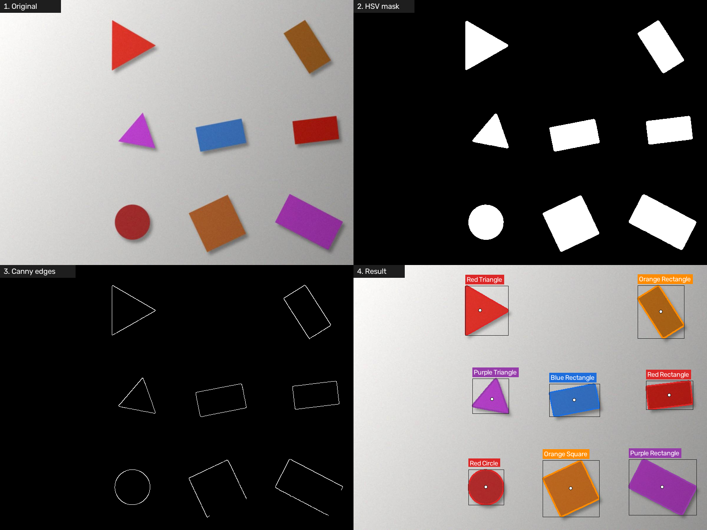
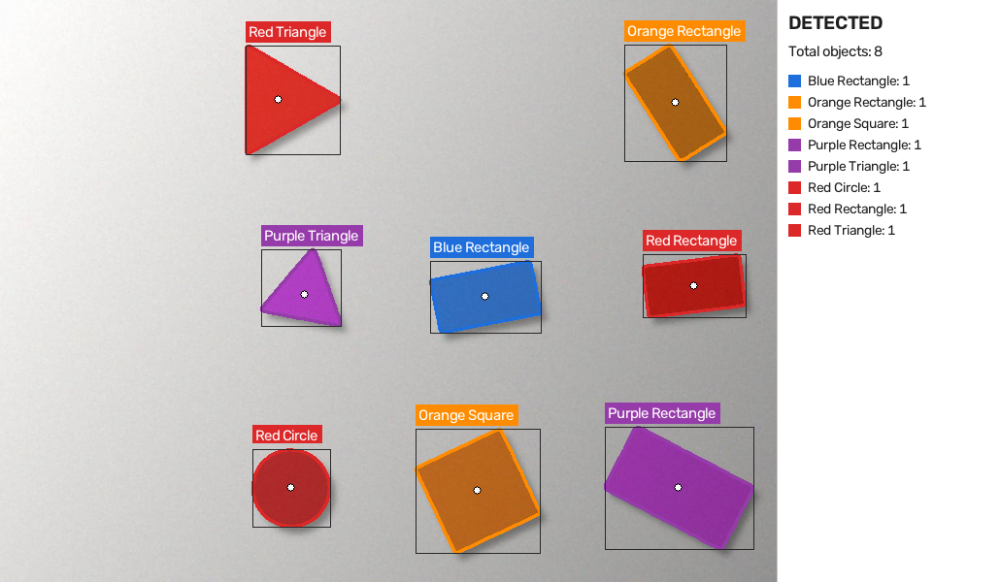
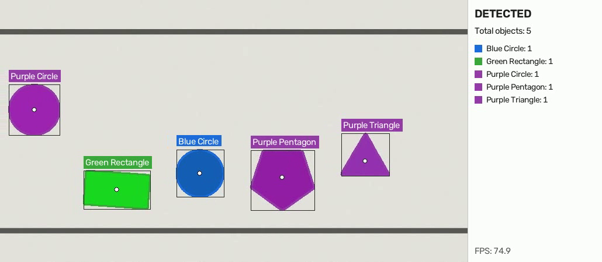

# Shape and Color Sorter

**CSC 126 – Computer Vision Midterm Project**
Caraga State University · College of Computing and Information Sciences

Members: Nur-medea O. Atega         Jobert Jan A. Bautista         Stu Brycir RH S. Monding

A Python + OpenCV application that finds colored shapes in an image, a recorded video, or a live webcam feed, labels each one by **color and shape** (for example, *Red Triangle*), and counts how many of each there are. It models the vision step of a sorting station, where items on a table or conveyor have to be identified before they can be sorted.



## Features

- Detects 7 colors (Red, Orange, Yellow, Green, Blue, Purple, Black) and 5 shapes (Triangle, Square, Rectangle, Pentagon, Circle)
- Works on a **static image**, a **recorded video**, or a **live webcam**
- Draws contours, bounding boxes, labels, centroids and a translucent mask overlay
- Side panel with totals per label and live FPS
- 4-panel pipeline view (Original → HSV mask → Canny edges → Result) for explaining each step
- Built-in accuracy evaluation against labelled test images

## OpenCV topics covered

| Lab topic | Where it is used |
|---|---|
| **(a) Image Operations** | Resizing, Gaussian blur, BGR→HSV conversion, drawing boxes/labels/overlays, `addWeighted` blending |
| **(b) Image Segmentation** | HSV color thresholding with `cv2.inRange`, morphological opening and closing |
| **(d) Image Analysis and Transformation** | Canny edges, `findContours`, `approxPolyDP` corner counting, `minAreaRect` aspect ratio, image moments, circularity |

## Setup

Requires Python 3.9 or newer.

```bash
git clone <your-repo-url>
cd shape-color-sorter
python -m venv venv
# Windows: venv\Scripts\activate     macOS/Linux: source venv/bin/activate
pip install -r requirements.txt
```

## How to run

```bash
# Static image
python main.py --image samples/hard_03.jpg

# Recorded video
python main.py --video samples/conveyor.mp4

# Live webcam (0 = built-in camera, 1 = external)
python main.py --webcam
python main.py --webcam 1
```

**Keys while the window is open**

| Key | Action |
|---|---|
| `v` | Switch between the Result view and the 4-panel pipeline view |
| `s` | Save a screenshot to `output/` |
| `p` | Pause / resume (video and webcam) |
| `q` or `Esc` | Quit |

Add `--no-display` to process without a window. Results are saved to `output/`.

### Other scripts

```bash
python make_samples.py   # regenerate the test images, ground truth and demo video
python evaluate.py       # measure accuracy against samples/ground_truth.json
python hsv_tuner.py --webcam   # calibrate color ranges for real paper and lighting
```

## How it works

1. **Preprocess** – resize to 800 px wide, Gaussian blur (5×5), convert to HSV.
2. **Segment** – for each color, `inRange` keeps pixels inside its HSV range (red uses two ranges because it wraps around the hue wheel). Opening removes specks; closing fills holes.
3. **Find objects** – `findContours` on each mask; contours under 600 px² are ignored as noise.
4. **Classify** – `approxPolyDP` (4% of perimeter) reduces the outline to its corners: 3 = Triangle, 4 = Square or Rectangle (decided by `minAreaRect` aspect ratio, so rotation doesn't matter), 5 = Pentagon. Otherwise, circularity `4πA/P² ≥ 0.80` = Circle.
5. **Visualize** – draw the contour, box, label and centroid, then the count panel.

## Results

Evaluated on 30 generated test images (307 objects) with known ground truth (`python evaluate.py`):

| Test set | Objects | Recall | Precision | Color correct | Shape correct |
|---|---|---|---|---|---|
| Clean (even lighting) | 100 | 100% | 100% | 100% | 100% |
| Hard (shadows, uneven light, noise, JPEG) | 97 | 100% | 100% | 100% | 100% |
| Stress (small, faded, dim, heavy noise) | 110 | 83.6% | 100% | 100% | 98.9% |
| **All** | **307** | **94.1%** | **100%** | **100%** | **99.7%** |

The recorded video runs at about 70+ FPS on a laptop CPU.

| Result | Video |
|---|---|
|  |  |

## Limitations

- Objects must have a **strong color**. White or very faded objects are not detected (12 of the 18 misses in the stress test).
- Very **small objects** (under about 600 px² after resizing) are filtered out as noise (the other 6 misses).
- **Touching or overlapping** shapes of the same color merge into one contour.
- Objects **cut off by the frame edge** can be misclassified.
- Color ranges are tuned for typical paper; strongly colored lights shift hues. Use `hsv_tuner.py` to recalibrate.

## Project structure

```
shape-color-sorter/
├── main.py             # entry point: image / video / webcam, display, keys
├── shape_detector.py   # vision pipeline: preprocess, segment, classify, draw
├── evaluate.py         # accuracy measurement against ground truth
├── make_samples.py     # generates test images, ground truth and demo video
├── hsv_tuner.py        # slider tool to calibrate HSV ranges
├── requirements.txt
├── samples/            # input images, ground_truth.json, conveyor.mp4
└── screenshots/        # output screenshots and accuracy report
```
